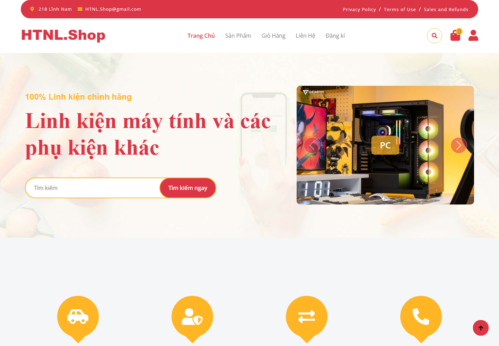
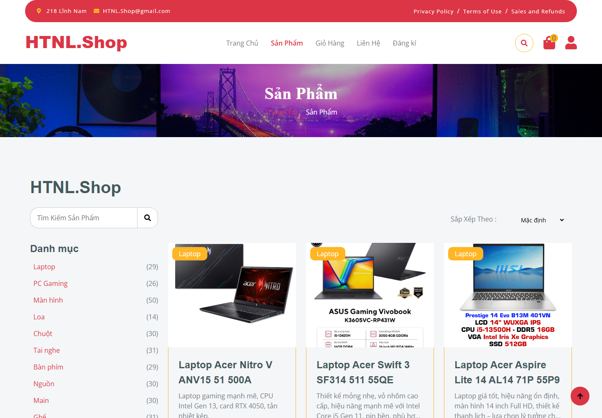
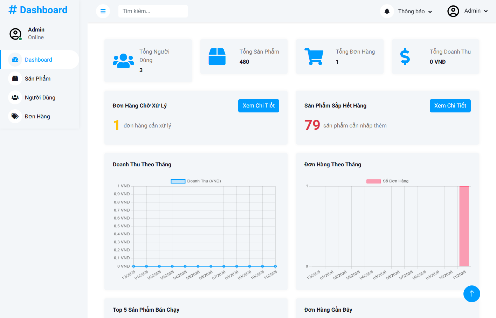
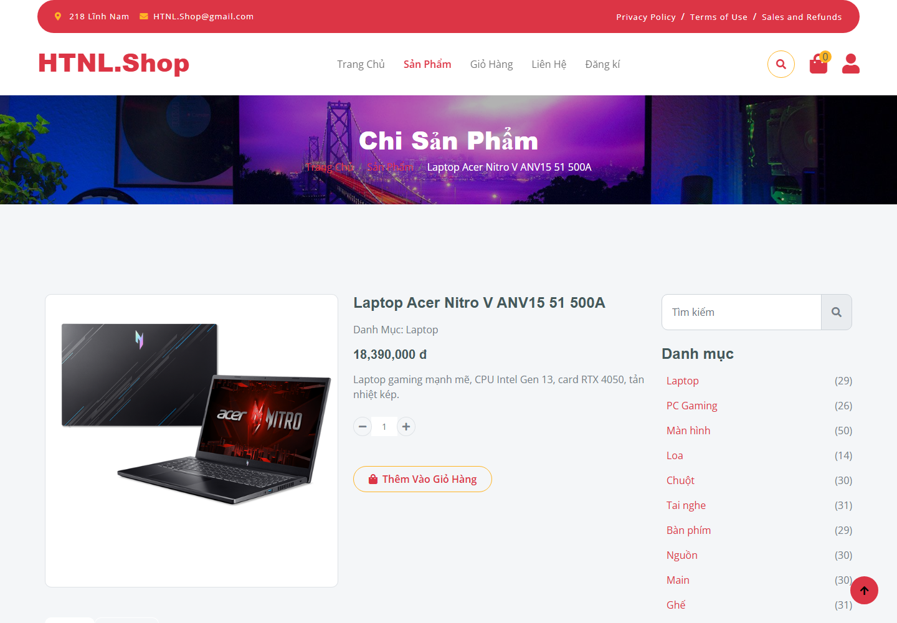
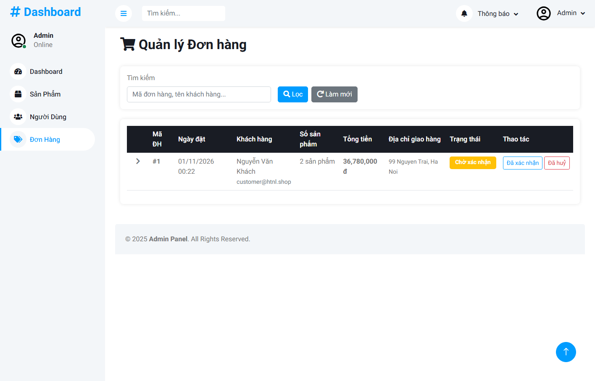

# HTNL Shop — Website bán máy tính & linh kiện

Website thương mại điện tử xây dựng bằng **ASP.NET Core MVC 8**, **Entity Framework Core 8**, **ASP.NET Core Identity** và **SQL Server**.

> Dự án được nâng cấp từ đồ án môn học lên mức "sản phẩm nhỏ vận hành được": có xác thực chuẩn, phân quyền theo vai trò,
> vòng đời đơn hàng, kiểm thử tự động và pipeline triển khai.



## Ảnh chụp

| Khách hàng | Quản trị |
|---|---|
|  |  |
|  |  |

Sơ đồ kiến trúc và luồng đặt hàng: [`docs/architecture.md`](docs/architecture.md).

---

## Tính năng

**Khách hàng**
- Xem danh mục, tìm kiếm, sắp xếp, phân trang sản phẩm (480 sản phẩm / 16 danh mục)
- Giỏ hàng cho khách vãng lai (session) — tự động gộp vào giỏ lưu CSDL khi đăng nhập
- Đặt hàng: thông tin người nhận, ghi chú, kiểm tra tồn kho, trừ kho trong transaction
- Lịch sử đơn hàng, chi tiết đơn, hồ sơ cá nhân
- Đánh giá sản phẩm (chỉ người đã mua, 1–5 sao)

**Quản trị**
- Dashboard: doanh thu (chỉ tính đơn đã giao/hoàn tất), đơn chờ xử lý, tồn kho thấp, top bán chạy
- Quản lý sản phẩm: thêm/sửa/xoá, upload ảnh, lọc theo danh mục, tìm kiếm, phân trang
- Quản lý người dùng: tạo tài khoản, đổi vai trò, đặt lại mật khẩu, chặn xoá khi đã có đơn
- Quản lý đơn hàng: chuyển trạng thái theo đúng luật (chờ xác nhận → đã xác nhận → đang giao → đã giao → hoàn tất),
  huỷ đơn tự động hoàn lại tồn kho, lọc theo trạng thái, tìm theo mã/tên/email

**Bảo mật**
- ASP.NET Core Identity: hash PBKDF2, khoá tài khoản sau 5 lần sai, cookie `HttpOnly` + `SameSite`
- Phân quyền theo vai trò (`Admin`, `Customer`), toàn bộ khu vực `/Admin` được bảo vệ
- Chống CSRF toàn cục cho mọi POST (kể cả AJAX)
- Chống IDOR: mọi truy vấn đơn hàng đều lọc theo người dùng hiện tại
- Security headers, trang lỗi 404/403/500 thân thiện, không lộ stack trace ở Production

---

## Chạy dự án

### Yêu cầu
- [.NET 8 SDK](https://dotnet.microsoft.com/download/dotnet/8.0)
- SQL Server: LocalDB trên Windows, SQL Server Express/Developer, hoặc dùng Docker Compose bên dưới.

Clone repository, rồi chạy các lệnh từ thư mục gốc vừa clone:

```bash
git clone https://github.com/Rayxez/WebBanLinhKienMayTinh.git
cd WebBanLinhKienMayTinh
dotnet restore
dotnet run --project HTNLShop.csproj
```

Ứng dụng tự tạo CSDL và seed dữ liệu khi chạy ở môi trường `Development`.

Nếu muốn tạo CSDL thủ công:

```bash
dotnet tool install --global dotnet-ef --version 8.0.11
dotnet ef database update --project HTNLShop.csproj
```

Mở URL được in ra trong terminal (cấu hình cổng trong `Properties/launchSettings.json`).

### Tài khoản demo

| Vai trò | Tên đăng nhập | Mật khẩu |
|---|---|---|
| Quản trị | `admin` | `Admin@12345` |
| Khách hàng | `customer` | `Customer@123` |

> Đây là tài khoản demo chỉ dùng cho môi trường Development. Không dùng lại các mật khẩu này ở môi trường khác.

### Chuỗi kết nối

Mặc định dùng LocalDB (`HTNLShop/appsettings.json`). Khi triển khai, đặt qua biến môi trường:

```bash
export ConnectionStrings__HTLNShop="Server=...;Database=...;User Id=...;Password=...;TrustServerCertificate=True"
```

### Chạy bằng Docker

Tạo file `.env` từ mẫu và thay các giá trị bằng mật khẩu riêng, đủ mạnh:

```powershell
Copy-Item .env.example .env
```

Không commit hoặc chia sẻ file `.env`.

```bash
docker compose up --build
```

- Web: <http://localhost:8080>
- SQL Server: `localhost:1433` (tài khoản `sa`, mật khẩu lấy từ `.env`)
- Health check: <http://localhost:8080/health>

Trong container, `Database__AutoMigrate=true` nên CSDL được tạo và seed tự động.

---

## Cấu trúc

```
HTNLShop/
├─ Controllers/          # Trang chủ, sản phẩm, giỏ hàng, đơn hàng, tài khoản, đánh giá
├─ Areas/Admin/          # Khu quản trị (kế thừa AdminBaseController → bắt buộc role Admin)
├─ Data/                 # DbContext, entity, OrderStatus, DbSeeder, design-time factory
├─ Services/             # CartMergeService (gộp giỏ session → CSDL)
├─ ViewModels/           # DTO cho view, tách khỏi entity
├─ Views/                # Razor
├─ Migrations/           # Migration khởi tạo (đã commit)
└─ docs/                 # Báo cáo đánh giá, lộ trình, backlog, tài liệu CV
```

---

## Kiểm thử

```bash
dotnet test
```

Bộ test hiện có **44 test** (xUnit + `WebApplicationFactory`), chạy trên một CSDL SQL Server riêng cho mỗi lần chạy:

- **Ma trận phân quyền**: 5 URL quản trị × 3 vai trò (ẩn danh / Customer / Admin)
- **CSRF**: POST thiếu token → 400 (3 case)
- **Security headers** + **health check** trên mọi response
- **Checkout end-to-end**: thêm giỏ → đặt hàng → kiểm tra trạng thái, `SalePrice`, tồn kho
- **Vòng đời đơn**: đi đủ 4 bước, huỷ đơn hoàn kho, chặn nhảy cóc trạng thái (14 case)
- **Domain**: trạng thái mặc định, doanh thu chỉ tính đơn đã giao, thành tiền, validate đăng ký

Coverage (loại trừ migration và Razor generated): **60,8% dòng** — cấu hình trong `tests/HTNLShop.Tests/coverlet.runsettings`.

---

## Trạng thái & lộ trình

Xem [`docs/BAO_CAO_DANH_GIA_VA_LO_TRINH.md`](docs/BAO_CAO_DANH_GIA_VA_LO_TRINH.md) và [`docs/TIEN-DO.md`](docs/TIEN-DO.md).

Đã hoàn thành:
- [x] Chuyển sang ASP.NET Core Identity, bỏ mật khẩu plaintext
- [x] Sửa lỗi đăng ký thành Admin, bảo vệ toàn bộ khu vực quản trị
- [x] CSRF toàn cục + token cho AJAX
- [x] Sửa IDOR đơn hàng, thêm `[Authorize]`
- [x] Vòng đời đơn hàng: mặc định "Chờ xác nhận", lưu `SalePrice`, thông tin người nhận
- [x] Trang lỗi 404/403/500, security headers, health check
- [x] Migration khởi tạo + seeder idempotent → clone là chạy
- [x] **44 test** (ma trận phân quyền, CSRF, checkout, vòng đời đơn, SEO) — coverage **60,8%** dòng (không tính mã sinh tự động)
- [x] **GitHub Actions** (build + test + coverage + vulnerability scan + Docker build)
- [x] **Dockerfile + docker-compose** (web + SQL Server, health check)
- [x] `rowversion` chống oversell, admin chuyển trạng thái đơn + huỷ hoàn kho
- [x] `decimal(18,2)` cho toàn bộ cột tiền
- [x] Ảnh sản phẩm nén **108,8 MB → 23,1 MB** (−79%), `wwwroot` 121 MB → 35,5 MB
- [x] SEO: title/meta động, Open Graph, `sitemap.xml`, `robots.txt`, cache tĩnh 7 ngày
- [x] Ảnh chụp + sơ đồ kiến trúc trong `docs/`

Tiếp theo:
- [ ] Thanh toán sandbox, email giao dịch
- [ ] Deploy staging + load test (k6) + Lighthouse
- [ ] Video demo theo kịch bản trong `docs/CV_VA_DEMO.md`

---

## Giấy phép & ghi công

Giao diện tham khảo template Bootstrap (HTML Codex) và Dashmin. Ảnh sản phẩm dùng cho mục đích học tập.
