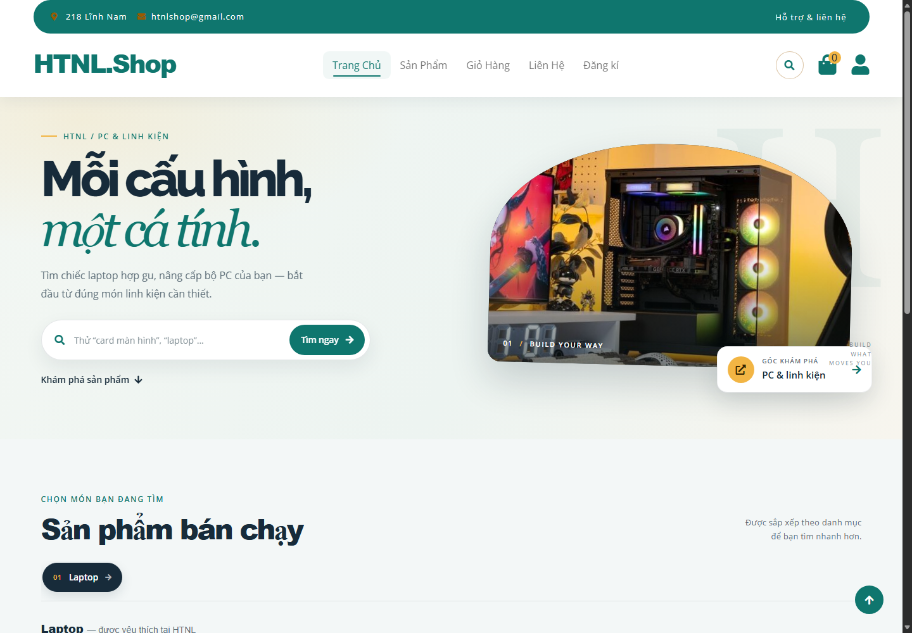
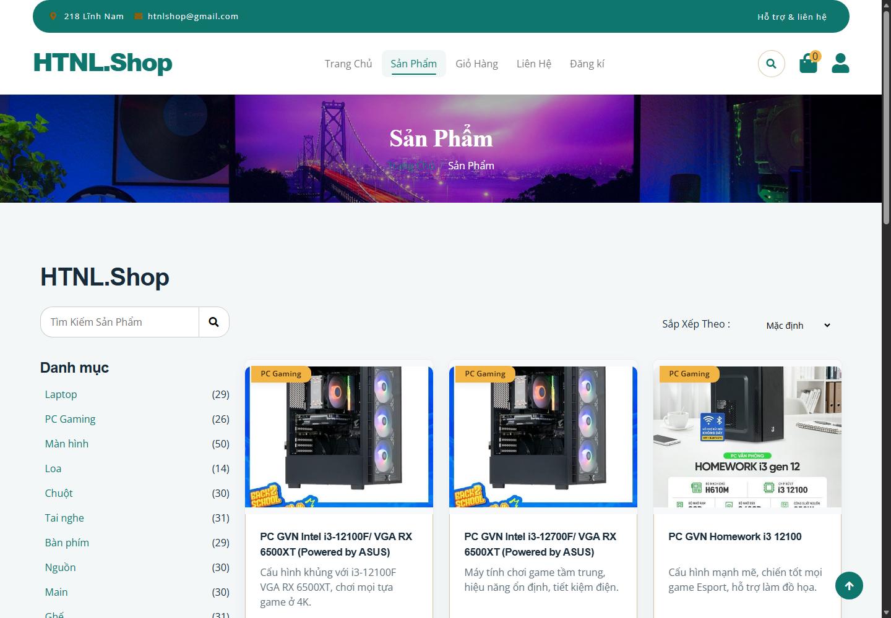
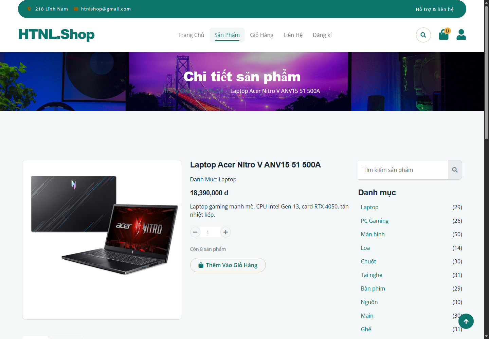
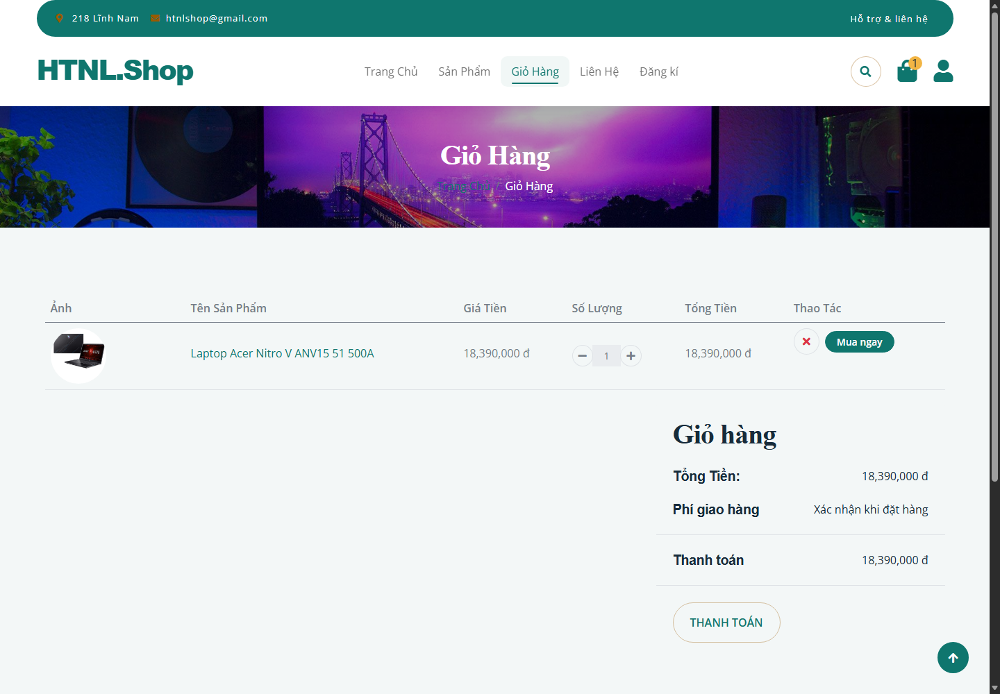

# HTNL Shop — Website bán máy tính & linh kiện

Website thương mại điện tử được xây dựng bằng **ASP.NET Core MVC 8**, **Entity Framework Core 8**, **ASP.NET Core Identity** và **SQL Server**. Dự án có giao diện mua sắm cho khách hàng, giỏ hàng và đặt đơn theo tồn kho, cùng khu vực quản trị phân quyền.

> Dự án cá nhân được phát triển từ đồ án môn học, bổ sung kiểm thử tự động, migration cơ sở dữ liệu, Docker và GitHub Actions.

## Giao diện



| Danh mục sản phẩm | Chi tiết sản phẩm |
|---|---|
|  |  |

| Giỏ hàng |
|---|
|  |

Xem thêm [sơ đồ kiến trúc và luồng đặt hàng](docs/architecture.md).

## Tính năng

### Khách hàng

- Duyệt, tìm kiếm, lọc danh mục, sắp xếp và phân trang sản phẩm.
- Thêm sản phẩm vào giỏ khách vãng lai; gộp giỏ vào tài khoản sau khi đăng nhập.
- Kiểm tra tồn kho khi cập nhật giỏ và đặt hàng.
- Xem lịch sử đơn hàng, chi tiết đơn và hồ sơ cá nhân.
- Đánh giá sản phẩm sau khi mua.

### Quản trị

- Dashboard doanh thu, đơn hàng, sản phẩm sắp hết và sản phẩm bán chạy.
- Quản lý sản phẩm: thêm, sửa, xóa, tải ảnh, tìm kiếm, lọc và phân trang.
- Quản lý tài khoản và vai trò.
- Xử lý vòng đời đơn hàng; hủy đơn sẽ hoàn lại tồn kho.

### Bảo mật và độ tin cậy

- ASP.NET Core Identity xử lý mật khẩu và đăng nhập; phân quyền theo vai trò `Admin` và `Customer`.
- Xác thực antiforgery cho các yêu cầu ghi dữ liệu, bao gồm AJAX.
- Kiểm tra quyền sở hữu khi truy cập đơn hàng.
- Dùng transaction và kiểm soát cạnh tranh tồn kho khi đặt hàng.
- Có security headers, trang lỗi thân thiện và health check tại `/health`.

## Công nghệ

- ASP.NET Core MVC 8, Razor
- Entity Framework Core 8, SQL Server
- ASP.NET Core Identity
- xUnit, `WebApplicationFactory`
- Docker Compose, GitHub Actions

## Chạy dự án trên máy cá nhân

### Yêu cầu

- [.NET 8 SDK](https://dotnet.microsoft.com/download/dotnet/8.0)
- SQL Server: LocalDB trên Windows, SQL Server Express/Developer hoặc Docker Compose.

Clone repository, sau đó chạy lệnh từ thư mục gốc:

```bash
git clone https://github.com/Rayxez/WebBanLinhKienMayTinh.git
cd WebBanLinhKienMayTinh
dotnet restore
dotnet run --project HTNLShop.csproj
```

Mặc định, `appsettings.json` sử dụng SQL Server LocalDB. Trong môi trường `Development`, ứng dụng tự chạy migration và tạo dữ liệu demo. Mở URL được in trong terminal.

### Tài khoản demo Development

| Vai trò | Tên đăng nhập | Mật khẩu |
|---|---|---|
| Quản trị | `admin` | `Admin@12345` |
| Khách hàng | `customer` | `Customer@123` |

Các tài khoản này chỉ dành cho chạy local trong môi trường Development. Không dùng các mật khẩu demo khi triển khai.

### Chạy bằng Docker Compose

Cài Docker Desktop hoặc Docker Engine có Docker Compose. Tạo `.env` từ tệp mẫu rồi thay các giá trị bằng mật khẩu mạnh, riêng cho môi trường của bạn:

```powershell
Copy-Item .env.example .env
```

Khởi chạy từ thư mục gốc:

```bash
docker compose up --build
```

- Website: <http://localhost:8080>
- Health check: <http://localhost:8080/health>
- SQL Server: `localhost:1433`

Docker Compose tự chạy migration và tạo tài khoản demo theo cấu hình. **Không commit hoặc chia sẻ `.env`**.

## Kiểm thử

Chạy tại thư mục gốc:

```bash
dotnet test
```

Bộ test xUnit gồm **44 bài**, kiểm tra domain, phân quyền, CSRF, checkout và vòng đời đơn hàng. Test cần SQL Server: mặc định dùng LocalDB trên Windows; có thể cấu hình SQL Server khác qua biến môi trường `HTNLSHOP_TEST_CONNECTION`.

GitHub Actions chạy restore, Release build, test kèm coverage, kiểm tra package có lỗ hổng đã biết và build Docker image.

## Cấu trúc thư mục

```text
Areas/Admin/    Controllers và views quản trị
Controllers/    Luồng sản phẩm, giỏ hàng, tài khoản, đơn hàng
Data/           EF Core context, entities, seeder, migrations
Services/       Các service dùng lại
ViewModels/     Model phục vụ views
Views/          Razor views và layout
tests/          Bộ kiểm thử tự động
docs/           Kiến trúc, ảnh chụp và tài liệu dự án
```

## Phạm vi hiện tại

- Checkout tạo đơn hàng; chưa tích hợp cổng thanh toán.
- Biểu mẫu liên hệ mở email nháp trong ứng dụng email của người dùng; website chưa gửi email từ máy chủ.
- Thanh toán sandbox, email giao dịch, triển khai staging và load test là các hướng phát triển tiếp theo.

## Ghi công

Giao diện tham khảo các template Bootstrap, gồm HTML Codex và Dashmin. Hình ảnh sản phẩm được sử dụng cho mục đích học tập và giới thiệu dự án cá nhân.
