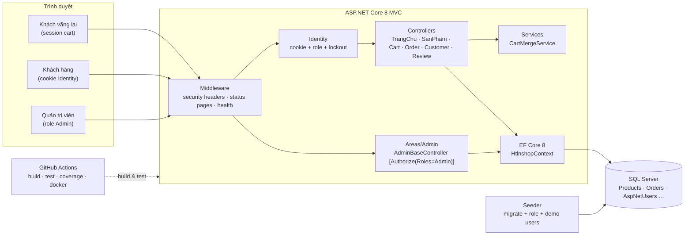
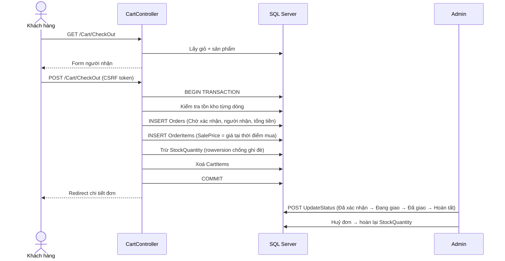

# Kiến trúc hệ thống — HTNL Shop

## 1. Tổng quan



## 2. Luồng đặt hàng



## 3. Trách nhiệm từng lớp

| Thành phần | Trách nhiệm | Không được làm |
|---|---|---|
| `Views` | Hiển thị, form + tag helper (tự sinh CSRF token) | Truy vấn dữ liệu, tính toán nghiệp vụ |
| `Controllers` | Nhận request, kiểm tra quyền, gọi dịch vụ, chọn view | Chứa logic nghiệp vụ phức tạp, SQL thủ công |
| `Areas/Admin` | Kế thừa `AdminBaseController` → bắt buộc role Admin | Tự khai báo `[Authorize]` rải rác |
| `Services` | Logic dùng lại (gộp giỏ hàng) | Phụ thuộc `HttpContext` ngoài `ISession` |
| `Data` | Entity, cấu hình EF, trạng thái đơn, seeder | Gọi HTTP, đọc `Request` |
| `ViewModels` | DTO cho view + validation | Chứa entity EF |

## 4. Các quyết định thiết kế (ADR tóm tắt)

| # | Quyết định | Lý do | Đánh đổi |
|---|---|---|---|
| 1 | Dùng ASP.NET Core Identity thay bảng `Users` tự viết | Hash PBKDF2, lockout, role, token reset có sẵn; tránh lỗi tự chế | Phải migrate schema, học API |
| 2 | Trạng thái đơn là chuỗi hằng trong `OrderStatus` + luật chuyển | Đọc được trong DB/HR, không cần lookup table | Chưa phải enum, so sánh chuỗi |
| 3 | Giỏ hàng kép: session cho khách, DB cho user, gộp khi đăng nhập | Giữ được khách vãng lai, không mất giỏ khi login | Hai nhánh code, cần test cả hai |
| 4 | `rowversion` trên `Product` | Chặn hai đơn cùng trừ một tồn kho | Phải xử lý `DbUpdateConcurrencyException` |
| 5 | Migration tự chạy khi Development / khi bật `Database:AutoMigrate` | Clone là chạy, demo nhanh | Production phải chủ động cấu hình |
| 6 | Test tích hợp dùng SQL Server thật (không InMemory) | Kiểm tra được transaction, rowversion, câu SQL | Chậm hơn, cần DB khi chạy test |

## 5. Bảo mật — các lớp phòng thủ

| Lớp | Cơ chế | Nơi cấu hình |
|---|---|---|
| Xác thực | Identity cookie `HttpOnly`, `SameSite=Lax`, hết hạn 8h, lockout 5 lần/15 phút | `Program.cs` |
| Phân quyền | `AdminBaseController` + `[Authorize(Roles="Admin")]` cho đơn hàng | `Areas/Admin/Controllers` |
| CSRF | `AutoValidateAntiforgeryToken` toàn cục + token trong AJAX | `Program.cs`, `Views/Cart/Index.cshtml` |
| IDOR | Mọi truy vấn đơn lọc theo `NameIdentifier` | `OrderController` |
| Input | DataAnnotations + kiểm tra phía server (giá, trạng thái, số lượng) | ViewModels, controllers |
| Lỗi | Trang 404/403/500 thân thiện, không lộ stack trace | `HomeController`, `StatusCode.cshtml` |
| Header | `X-Content-Type-Options`, `X-Frame-Options`, `Referrer-Policy` | Middleware trong `Program.cs` |
| Dữ liệu | Không seed mật khẩu mặc định ngoài Development | `DbSeeder` |

## 6. Kiểm thử

```
44 test
├─ DomainTests              4   (trạng thái mặc định, doanh thu, thành tiền, validate)
├─ OrderStatusTests        11   (luật chuyển trạng thái, hoàn kho)
├─ AuthorizationMatrixTests 18  (5 URL × 3 vai trò + đơn hàng/hồ sơ)
├─ SecurityTests            7   (CSRF ×2, header, health, sitemap, robots, meta)
├─ CheckoutTests            1   (đặt hàng, SalePrice, tồn kho)
└─ OrderLifecycleTests      3   (vòng đời, huỷ hoàn kho, chặn nhảy cóc)
```

Coverage (loại trừ migration và Razor generated): **60,8% dòng**, 25,4% nhánh.
